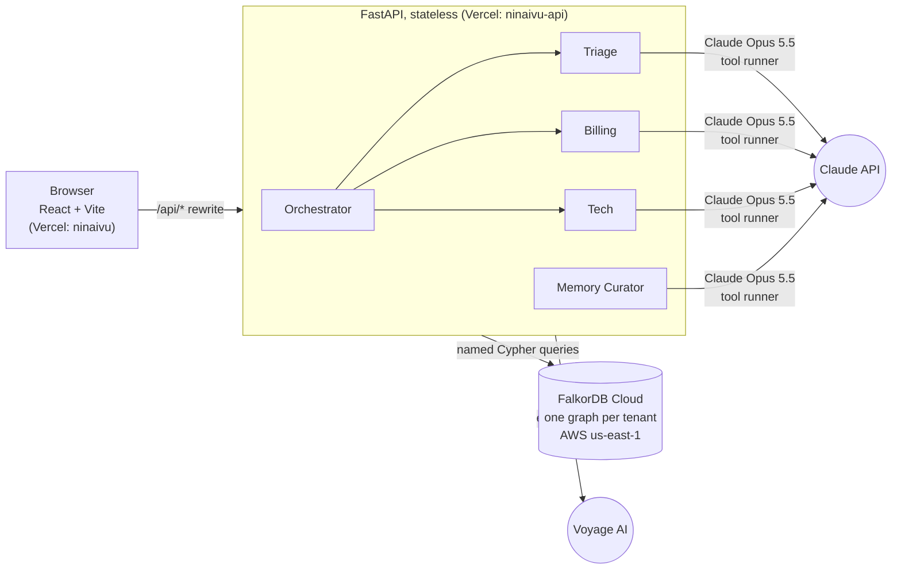
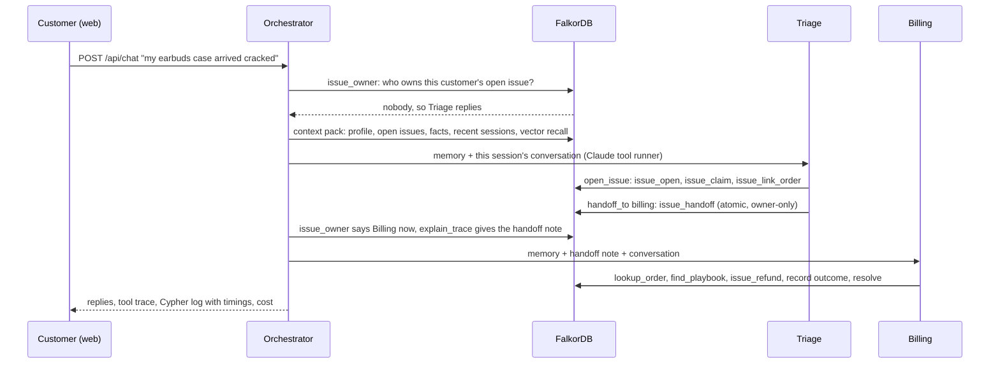
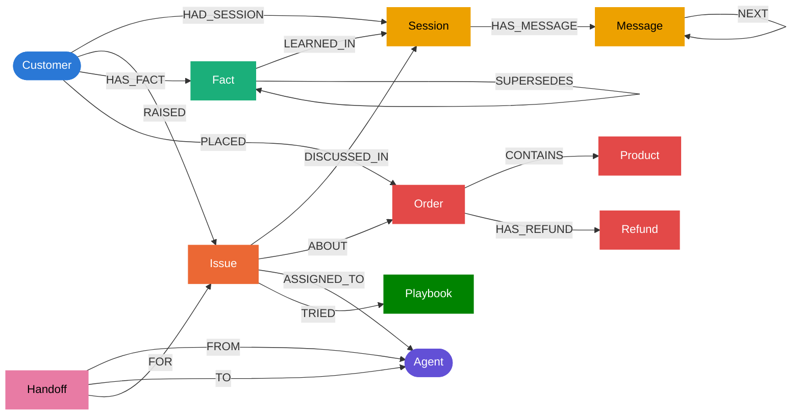

# Ninaivu

**Graph memory for support agent swarms, built on FalkorDB.**
Graph Hacks: Context for AI Agents (WeMakeDevs × FalkorDB) · **Track 02: Agent Memory and Coordination**

**Live demo: <https://ninaivu-peach.vercel.app>** · API health: <https://ninaivu-api.vercel.app/api/health>

*Ninaivu* (நினைவு) is Tamil for "memory".

---

## What it does

A fictional company's support desk runs three agents (**Triage**, **Billing**, **Tech**) plus a **Memory Curator**.
The agents never share an LLM conversation. **They coordinate only through the graph**:

- **Who owns an issue** is an `ASSIGNED_TO` edge. The backend reads it on every turn to decide which agent replies.
- **Handoffs** are `Handoff` nodes carrying a reason and a context note, so the next agent continues without re-asking.
- **What we know about the customer** lives in `Fact` nodes with embeddings, validity windows, and a `SUPERSEDES` history.
- **Which fix works** is learned: every playbook attempt is a `TRIED {success}` edge feeding a success rate.

A week later the customer asks "any update?" and the agent already knows the order, the refund, who handled it, and that
they prefer WhatsApp. It never asks for the order number again.

**The graph is not decoration.** The FastAPI backend is stateless: routing, memory, history and handoffs are all read
from FalkorDB on every turn. Remove FalkorDB and no agent can reply.

## How it maps to Track 02

| Track 02 focus | Ninaivu |
|---|---|
| Episodic memory | `Session` → `Message` timeline; curator-written session summaries; `Issue` ↔ `Session` links |
| Semantic memory | `Fact` nodes: vector index (Voyage `voyage-4-lite`, 1024-d), `valid_from`/`valid_to`, `SUPERSEDES` chain, `LEARNED_IN` provenance |
| Procedural memory | `Playbook` nodes ranked by learned success rate; every attempt recorded as `TRIED {success}` |
| Persistent conversation history | Every message stored, chained with `NEXT` |
| Shared state and handoffs | `(Issue)-[:ASSIGNED_TO]->(Agent)` is the single source of truth; atomic, owner-only handoff query |
| High-concurrency reads/writes | Load test: 50 concurrent customers, FalkorDB p50 **0.18 ms** / p99 **0.59 ms**; race of 10 claims → exactly 1 winner |
| Separate memory per user/tenant | One FalkorDB graph per tenant (`tenant_acme`, `tenant_zenfiber`); every query is anchored on the customer, and tools are bound to `(tenant, customer)` server-side, so the model never supplies ids |

## Architecture



### One customer turn



In production the whole turn spends about **40 ms inside FalkorDB across 32 queries**. The rest is model time.

## Graph data model

Each tenant has its own graph. Colours follow the UI's graph view.



| Label | Key properties | Role |
|---|---|---|
| `Customer` | `id`, `name`, `tier` | anchor for per-user memory |
| `Session` | `id`, `started_at`, `ended_at`, `channel`, `summary`, `sentiment` | episodic |
| `Message` | `id`, `seq`, `role`, `agent`, `text`, `ts` | conversation history |
| `Issue` | `id`, `title`, `category`, `status`, `opened_at`, `resolved_at`, `resolution` | shared state |
| `Fact` | `id`, `key`, `text`, `embedding` (vecf32, 1024-d), `valid_from`, `valid_to` | semantic memory |
| `Playbook` | `id`, `name`, `category`, `steps`, `success_count`, `fail_count`, `embedding` | procedural memory |
| `Agent` | `name`, `role` | the team |
| `Handoff` | `id`, `reason`, `context`, `ts` | coordination, explainability |
| `Order` / `Product` / `Refund` | `id`, `amount`, `status`, `date` / `sku`, `name`, `price` / `id`, `amount`, `status`, `by_agent` | domain |

Edge properties: `ASSIGNED_TO {since}`, `TRIED {success, at}`. Timestamps are epoch seconds. Indexes: range indexes on
every `id`/`name`, plus HNSW vector indexes (cosine) on `Fact.embedding` and `Playbook.embedding`
([`00_schema.cypher`](server/queries/00_schema.cypher)).

## Cypher queries the product depends on

Every query is a file in [`server/queries/`](server/queries), loaded by name at runtime, so this table, the code and the
UI's **Cypher queries** tab all show the same text. `$cid` anchors almost every query on one customer.

| Query | What it does | Used by |
|---|---|---|
| [`issue_owner`](server/queries/issue_owner.cypher) | **Routing**: which agent owns the customer's newest open issue | orchestrator, every turn |
| [`customer_profile`](server/queries/customer_profile.cypher), [`context_open_issues`](server/queries/context_open_issues.cypher), [`context_recent_sessions`](server/queries/context_recent_sessions.cypher), [`context_facts`](server/queries/context_facts.cypher) | The context pack: who, open issues with owner and order, last 3 session summaries, current facts | orchestrator, every agent run |
| [`semantic_recall`](server/queries/semantic_recall.cypher) | **Vector + graph**: nearest facts by meaning, filtered to this customer's current facts | context pack, `search_memory` tool |
| [`session_start`](server/queries/session_start.cypher), [`session_end`](server/queries/session_end.cypher) | Open a session; close it with the curator's summary and sentiment | orchestrator, curator |
| [`message_append`](server/queries/message_append.cypher), [`message_link`](server/queries/message_link.cypher), [`session_messages`](server/queries/session_messages.cypher) | Persistent history: append, chain with `NEXT`, read the transcript back | orchestrator, curator |
| [`issue_open`](server/queries/issue_open.cypher), [`issue_link_order`](server/queries/issue_link_order.cypher), [`issue_link_session`](server/queries/issue_link_session.cypher), [`issue_resolve`](server/queries/issue_resolve.cypher) | Issue lifecycle; the order link only succeeds if the order is this customer's | `open_issue`, `link_order`, `resolve_issue` tools; orchestrator |
| [`issue_claim`](server/queries/issue_claim.cypher) | **Race-safe claim**: assigns only if unassigned (10 concurrent claims → 1 winner) | `open_issue` tool |
| [`issue_handoff`](server/queries/issue_handoff.cypher) | **Atomic handoff**: moves `ASSIGNED_TO` and writes a `Handoff`; zero rows if the caller isn't the owner | `handoff_to` tool |
| [`explain_trace`](server/queries/explain_trace.cypher) | The handoff chain for an issue; the latest note is given to the receiving agent | orchestrator, `/api/trace` |
| [`issue_history`](server/queries/issue_history.cypher) | "What did they ask last month, and was it resolved?" with the fix that worked | `issue_history` tool |
| [`fact_current`](server/queries/fact_current.cypher), [`fact_close_current`](server/queries/fact_close_current.cypher), [`fact_create`](server/queries/fact_create.cypher), [`fact_link_supersedes`](server/queries/fact_link_supersedes.cypher) | Semantic memory update: skip no-ops, close the old version, create the new one with provenance, link `SUPERSEDES` | `remember_fact` tool, curator |
| [`playbook_find`](server/queries/playbook_find.cypher) | **Procedural memory**: vector search, keep near-equal matches, rank by learned success rate | `find_playbook` tool |
| [`playbook_record_outcome`](server/queries/playbook_record_outcome.cypher) | Learn from an attempt: `TRIED {success}` edge + counters | `record_playbook_outcome` tool |
| [`order_lookup`](server/queries/order_lookup.cypher), [`refund_create`](server/queries/refund_create.cypher) | Domain tools, scoped to the customer | `lookup_order`, `issue_refund` tools |
| [`customer_graph`](server/queries/customer_graph.cypher), [`customer_fact_history`](server/queries/customer_fact_history.cypher), [`customers_list`](server/queries/customers_list.cypher) | UI: two-hop memory neighbourhood, fact versions, customer picker | web app |
| [`stretch_recurring_issues`](server/queries/stretch_recurring_issues.cypher) | `algo.labelPropagation` over issues and orders to spot recurring incidents. **Prototype, not used by the product yet** | none |

Two examples:

```cypher
// issue_handoff: only the current owner can hand off (zero rows = rejected)
MATCH (:Customer {id: $cid})-[:RAISED]->(i:Issue {id: $iid})-[r:ASSIGNED_TO]->(from:Agent {name: $from_agent})
MATCH (to:Agent {name: $to_agent})
DELETE r
CREATE (i)-[:ASSIGNED_TO {since: $now}]->(to)
CREATE (h:Handoff {id: $hid, reason: $reason, context: $context, ts: $now})
CREATE (h)-[:FROM]->(from), (h)-[:TO]->(to), (h)-[:FOR]->(i)
RETURN h.id AS handoff_id
```

```cypher
// semantic_recall: vector search, then the graph keeps only this customer's current facts
CALL db.idx.vector.queryNodes('Fact', 'embedding', 20, vecf32($qvec)) YIELD node, score
MATCH (:Customer {id: $cid})-[:HAS_FACT]->(node)
WHERE node.valid_to IS NULL
RETURN node.key AS key, node.text AS text, score AS distance
ORDER BY distance
LIMIT 5
```

## Agents and tools

| Agent | Job | Tools | Effort |
|---|---|---|---|
| Triage | Greets using memory, classifies, opens and hands off issues | `search_memory`, `issue_history`, `open_issue`, `link_order`, `handoff_to`, `remember_fact` | low |
| Billing | Refunds, charges, deliveries | `search_memory`, `lookup_order`, `issue_refund`, `find_playbook`, `record_playbook_outcome`, `open_issue`, `resolve_issue`, `handoff_to`, `remember_fact` | medium |
| Tech | Troubleshooting with playbooks | `search_memory`, `find_playbook`, `record_playbook_outcome`, `open_issue`, `resolve_issue`, `handoff_to`, `remember_fact` | medium |
| Memory Curator | At session end: summary, sentiment, lasting facts (supersedes old versions) | structured output | low |

All agents run on Claude Opus 5.5 (`claude-opus-5-5`) through the Anthropic SDK's tool runner, with server-side refusal
fallback enabled. Tools are Python closures bound to `(tenant, customer, session, agent)`, so the model never passes ids.
Handoffs inside one request are followed up to two hops. Each customer turn costs about $0.05; the UI shows the cost of
every turn.

## Tests and numbers

- **24 tests**: 17 offline (tool schemas never expose ids, handoff flow, curator, API, cost maths) and 7 live against
  FalkorDB that run every named query, including a 10-thread claim race and tenant isolation.
- **Load test** ([results](server/scripts/load_test_results.md)): 50 concurrent customers, 1,912 queries,
  FalkorDB server time p50 0.18 ms / p99 0.59 ms; race and isolation pass.
- **Production**: a full agent turn spends ~40 ms in FalkorDB (32 queries), because Vercel and FalkorDB Cloud both run in
  AWS us-east-1.

## Repo layout

```
server/                 FastAPI backend (Vercel Python function)
  main.py               API routes
  ninaivu/              config, db, memory, coordination, embeddings, llm (cost tracking), agents/
  queries/*.cypher      every Cypher query the product runs, loaded by name
  seed/                 synthetic data generator + playbooks.yaml
  scripts/              demo_cli, load_test, usage_report
  tests/                pytest (offline + live)
web/                    React + Vite + TypeScript (Vercel static site)
docs/DEMO_SCRIPT.md     demo video script and shot list
PLAN.md                 the execution plan
```

## Run it locally

Prerequisites: Python 3.11+, Node 20+, a FalkorDB instance (FalkorDB Cloud free tier, or `docker compose up -d`), an
Anthropic API key and a Voyage AI key.

```bash
cp .env.example .env                      # fill in FALKORDB_*, ANTHROPIC_API_KEY, VOYAGE_API_KEY

cd server
python -m venv .venv && source .venv/bin/activate     # Windows: .venv\Scripts\activate
pip install -r requirements-dev.txt
pytest                                                # offline tests (no DB, no keys)
FALKORDB_TEST=1 pytest                                # + live tests against FalkorDB
python -m seed.generate_data --tenant all --reset     # --fake-embeddings skips Voyage
python -m scripts.demo_cli --tenant acme --customer c-001   # two-session demo in the terminal (~$0.30)
python -m scripts.load_test                           # concurrency, race, isolation (no LLM calls)
python -m scripts.usage_report                        # Claude spend from the local ledger
uvicorn main:app --reload --port 8000

cd ../web
npm install
npm run dev                                           # http://localhost:5173, proxies /api to :8000
```

## Deploy (two Vercel projects, one repo)

| Project | Root | Domain | Settings |
|---|---|---|---|
| `ninaivu-api` | `server` | ninaivu-api.vercel.app | FastAPI preset. Env: `FALKORDB_HOST/PORT/USERNAME/PASSWORD/SSL`, `ANTHROPIC_API_KEY`, `NINAIVU_MODEL`, `VOYAGE_API_KEY`, `VOYAGE_MODEL`, `EMBED_DIM` (leave `USAGE_LEDGER` unset) |
| `ninaivu` (web) | `web` | ninaivu-peach.vercel.app | Vite preset, no env vars. `web/vercel.json` rewrites `/api/*` to the API project, so the browser sees one origin |

The FalkorDB Cloud free tier stops after a day without use and keeps no data across restarts. If the demo looks empty,
re-seed with `python -m seed.generate_data --tenant all --reset`.

## Data

All data is synthetic and generated by [`server/seed/`](server/seed): two fictional companies (Acme Store, ZenFiber
Broadband), Faker names with a fixed seed, hand-written playbooks and past sessions. No real, private or personal data
is used. Customer ids overlap across tenants on purpose, to demonstrate isolation.

## AI assistance disclosure

This project was built with substantial help from **Claude Code** (Anthropic's AI coding assistant, running Claude
Opus 5.5), as the hackathon rules allow.

- **The team** chose the track and the idea, reviewed and approved the execution plan ([PLAN.md](PLAN.md)), made the
  stack and hosting decisions (React on Vercel instead of Streamlit), set up FalkorDB Cloud, the API keys, GitHub and
  Vercel, and reviewed and tested the results at each step.
- **Claude Code** drafted the plan and wrote most of the code, Cypher queries, tests and documentation under that
  direction, and ran the tests, seeding, load test and deployment checks.
- **At runtime**, the product itself uses Claude Opus 5.5 for the agents and the curator, and Voyage AI for embeddings.

Every query and design decision is documented above and in [PLAN.md](PLAN.md), and the team can walk through any of it.
